# Recognition

A bar plugin for [Omarchy](https://omarchy.org) that shows who is home. Give each
person an emoji and the devices they carry; while one of those devices is on your
network, their emoji sits in the bar. When the last one leaves, the emoji goes away.

No root, no daemon, no account, nothing leaves the machine: an `nmap -sn` sweep of
your own subnet every 20 seconds, from the shell that is already running.

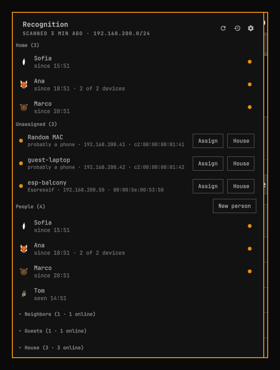

## Install

```bash
omarchy plugin add https://github.com/FerC10110/omarchy-recognition.git --enable
```

Needs `nmap` and `ip` (iproute2) — `omarchy pkg add nmap`; `ip` ships with the
system. `avahi-resolve` (avahi) is optional and only looks up a device's network
name.

To remove it:

```bash
omarchy plugin disable io.github.ferc10110.recognition
omarchy plugin remove io.github.ferc10110.recognition
```

## First run

The first scan is silent: everything answering on the network lands under
**Unassigned**, with no notifications. Two minutes of setup:

1. Put whatever is always there and is not a person into **House** — router,
   printer, TV, this PC. Rename them so you can tell them apart.
2. **Assign** each phone or laptop to a person. Vendor and network name help; a
   "Random MAC" is almost always a phone.

From then on, arrivals, departures and new devices are announced.

---

## Who is home, in the bar


One emoji per person, in the order they arrived. `👤` is a connected guest, and
`+3` counts the devices nobody has claimed yet. Most days the bar is the whole
plugin — click it for everything below.

The panel resizes from the ◢ in its corner and moves by dragging its title strip;
both are remembered. Hovering a person shows their devices, their MACs and IPs,
and when each was last seen.

## Unknown devices, assigned in two clicks

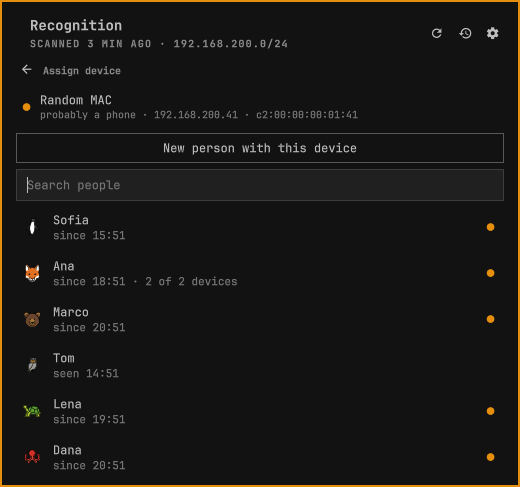

A phone that has never been on your Wi-Fi shows up at the top of the panel with
its vendor, its network name and its IP. **Assign** hands it to someone — search
the people you have, or make a new one right there — and **House** files it away
as furniture that never notifies.

## People

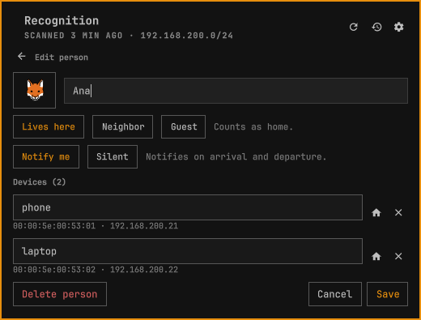

A person is a name, an emoji and their devices. Each device has a little house
switch: on, it says where they are; off, it stays theirs — still in the tooltip,
still right-clickable, still reachable from a command — but it stops moving them
home. That is the desktop PC that never leaves.

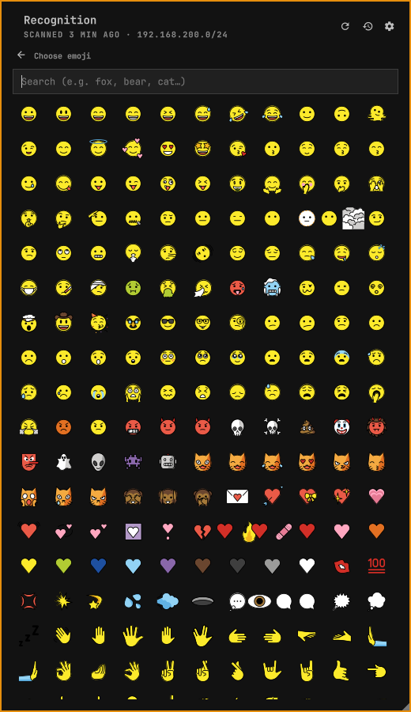

Every emoji your system can draw, searchable by name.

### Neighbors and guests

Not everyone on your Wi-Fi lives with you.

A **neighbor** is someone you gave the password to, connected from their own
place. They keep their name, emoji and devices, get their own section and their
own notifications, and never count as someone being home — so "Home" and the bar
keep meaning the people you live with.

A **guest** is in your house. Own section, own events, a `👤` in the bar, and with
**Guests keep the house occupied** on (the default) they keep the house from going
empty while they are around.

## Network alerts

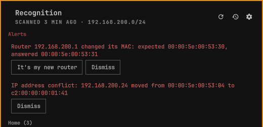

Two, both heuristics worth a look rather than a panic:

- the router answering with a **different MAC** than it did before — the classic
  sign of ARP spoofing, and also what a new router looks like ("It's my new
  router" accepts it once);
- an **IP conflict**: an address taken over by another device while the previous
  one is still around.

## Commands

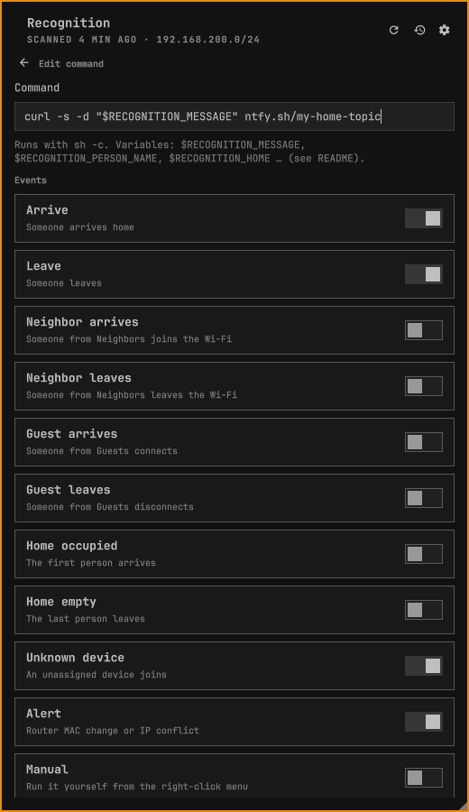

A command is one line, run with `sh -c`, on the events you tick:

| Event | When |
|---|---|
| Arrive / Leave | Someone comes home or goes. Once per person. |
| Neighbor arrives / leaves | Someone in Neighbors joins or leaves the Wi-Fi. |
| Guest arrives / leaves | Someone in Guests connects or disconnects. |
| Home occupied / empty | The first person arrives, the last one leaves. |
| Unknown device | Something unassigned joins, on every visit until you file it. |
| Alert | A router MAC change or an IP conflict. |
| Manual | Never on its own — you pick it from the right-click menu. |

Commands can be filtered to particular people. They run in the background, up to
eight at a time, each stopped after 30 seconds, so they never slow a scan down.
**Test** in the editor runs one right away with example data and shows its exit
code. Neither the notification switches nor a person's "Silent" affect them:
silencing a notification should not quietly break an automation.

```sh
# A push to your phone with ntfy.sh (Arrive, Leave, Unknown device, Alert)
curl -s -d "$RECOGNITION_MESSAGE" ntfy.sh/<your-topic>

# A Home Assistant webhook (Home occupied, Home empty)
curl -s -X POST -H 'Content-Type: application/json' -d "$RECOGNITION_JSON" \
  http://homeassistant.local:8123/api/webhook/<webhook-id>

# A sound on this PC (Arrive, with one person picked)
paplay /usr/share/sounds/freedesktop/stereo/complete.oga
```

The details arrive **only** as environment variables; the command text is never
rewritten, and `sh` never runs a variable's value as code — which matters, because
a device's network name is chosen by whoever owns the device. Quote them anyway
(`"$RECOGNITION_MESSAGE"`) so spaces survive.

| Variable | Events | Value |
|---|---|---|
| `RECOGNITION_EVENT` | all | `arrive`, `leave`, `neighbor-arrive`, `neighbor-leave`, `guest-arrive`, `guest-leave`, `home-occupied`, `home-empty`, `unknown`, `alert` or `manual` |
| `RECOGNITION_MESSAGE` | all | The notification text, e.g. `Ana arrived home` |
| `RECOGNITION_PERSON_ID`, `_NAME`, `_EMOJI` | person events, `home-*`, manual | The person; for `home-*`, the first to arrive or the last to leave |
| `RECOGNITION_HOME`, `RECOGNITION_HOME_COUNT` | all | Who is home now, and how many — the household only, never neighbors or guests |
| `RECOGNITION_GUESTS`, `RECOGNITION_GUEST_COUNT` | all | The guests connected now, and how many |
| `RECOGNITION_DEVICE_MAC`, `_IP`, `_VENDOR`, `_HOSTNAME` | `unknown`, manual | The new device, or the one you right-clicked |
| `RECOGNITION_ALERT_KIND`, `RECOGNITION_ALERT_IP` | `alert` | `gateway-mac` or `ip-conflict`, and the address involved |
| `RECOGNITION_JSON` | all | The whole event as JSON |

### Manual commands

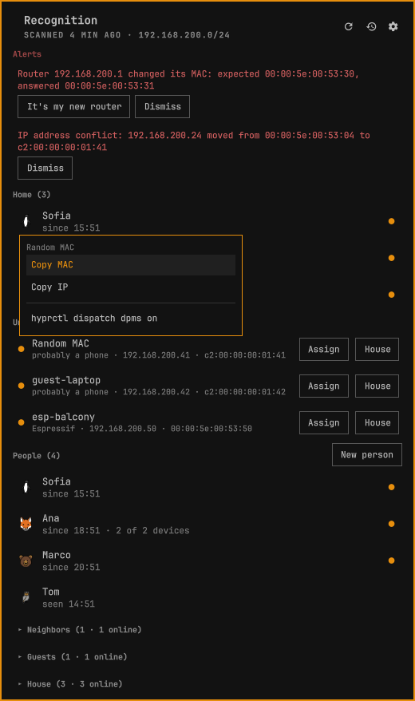

Mark a command **Manual** and it leaves the automatic ones for the right-click
menu of any person or device, where it runs only when you pick it.
`RECOGNITION_DEVICE_MAC` and `_IP` point at whatever you clicked — so a
wake-on-LAN can name the desktop while presence still follows the phone. When a
person has several devices the menu asks which one first. Whatever the command
prints comes back in the panel, and is forgotten when you close it.

A command can be both: tick Arrive **and** Manual and it runs on its own *and*
whenever you pick it.

### Commands from Obsidian

If you use [Readily](https://plugins.omarchy.org/plugin.html?id=io.github.ferc10110.readily)
([source](https://github.com/FerC10110/omarchy-readily)) to keep notes in Obsidian,
Recognition can run the commands you keep there. Turn on **Read commands from
Readily** in Settings — it starts off.

A command is a fenced code block in any Readily note, tagged `#recognition`:

````markdown
## Wake the desktop #recognition/arrive #recognition/manual
```
wol 00:00:5e:00:53:09
```
````

`#recognition` on its own makes it manual; `#recognition/<event>` also runs it on
that event, using the names from the table above. A tag in the note's frontmatter
applies to every item in it, so one note can be "everything I run when the house
empties". A sub-tag that is not an event is ignored — a typo never makes something
run on its own. Recognition reads at most 50, up to 1000 characters each, and
never writes to your vault. They run for everyone; narrow one down inside the note
itself: `[ "$RECOGNITION_PERSON_NAME" = "Ana" ] || exit 0`.

**Before you turn it on:** anything you tag runs on this machine, unattended, as
you. If your vault syncs from another device, whatever gets tagged there will run
here the next time that event happens.

## History

Off by default. Turn on **Keep a history** in Settings and Recognition starts
recording how long each person is home — nothing before that moment, and nothing
at all while the switch is off.

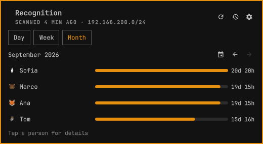

The dashboard, behind the clock icon, compares everyone over a day, a week or a
month.

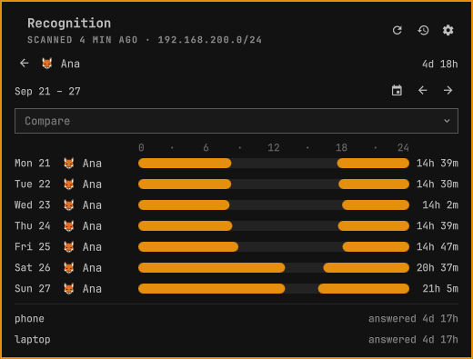

Opening a person lays their period out as a grid: a row per day, the hours lined
up from one day to the next, the day's total on the right, and their devices
underneath. **Compare** adds other people to the same grid.

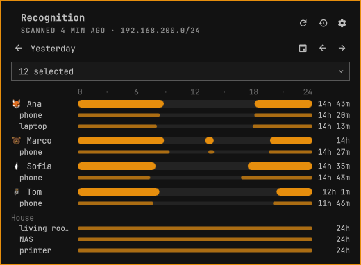

Tapping a day opens it on its own, one lane per subject — each person with their
devices under them, then the house, then whatever else was on the network that
day. **Who** picks the lanes, and remembers.

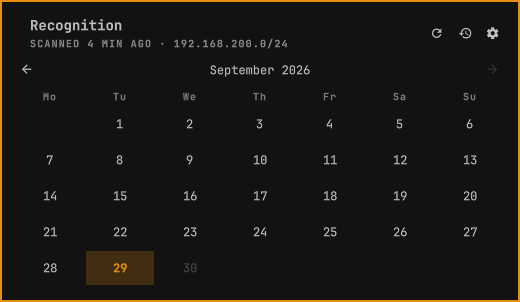

The arrows step one period at a time; the calendar icon beside them opens a month
of days. Pick one and the dashboard jumps there keeping the period it was on — the
12th picked from a week lands on the week of the 12th. Days before the history
begins, or after today, are shown but cannot be picked.

Two dials live next to the switch. **Keep details for N days** (30) decides when a
day drops its times and keeps only its totals — so an old day still says how long
someone was home, but not when. **Track devices** (No) decides how much of the
network is recorded: people only, the devices you have assigned, or everything
that answers.

A caveat worth knowing: "on" means "answered on the network". Asleep and shut down
look identical, and many suspended machines keep answering so Wake-on-LAN can
reach them — on those, going to sleep looks like staying on. And when the scanner
was not running at all, nothing was measured: if presence changed across the gap,
that time is counted separately as not measured rather than guessed.

History lives in `~/.local/share/recognition/history/YYYY-MM.json`, one file per
month, readable and yours.

## Settings

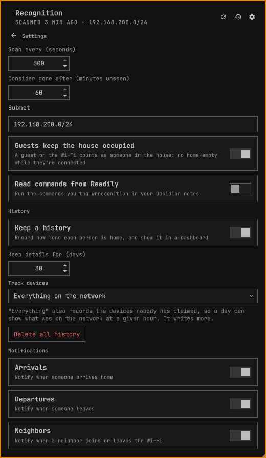

Scan interval and grace period, the subnet to scan, the guest and Obsidian
switches, the history dials, and one notification switch per kind: arrivals,
departures, neighbors, guests, new devices, network alerts and **Home**. Home is
the only one that starts off — turn it on for "Home is occupied (Ana arrived)" and
"Home is empty (Juan left)". The switch in Settings is the master; each person's
own switch decides whether they are covered.

## How it works

Every scan runs `nmap -sn` over your subnet without privileges. The useful part is
the side effect: the kernel resolves each address with ARP, and phones answer ARP
even while they sleep. A device counts as seen when the kernel confirms its ARP
entry or nmap sees it up, and a person is home while any device that counts for
them was seen within the grace period (5 minutes), so a sleeping phone does not
flicker in and out.

Three files, all yours:

- `~/.config/recognition/people.json` — people, House devices, commands and
  settings. Editable by hand; the panel reloads it.
- `~/.local/state/recognition/state.json` — what the scanner has seen. A cache:
  delete it and the next scan rebuilds it, silently.
- `~/.local/state/recognition/commands.json` — the last result of each command.
  Also a cache.

## Limitations

- Phones use a random MAC per Wi-Fi network. It stays put until the owner resets
  it or turns on rotation; then the phone looks new. When it keeps its network
  name, Recognition offers the owner ("🐻 Ana?") and one click moves it over —
  but only when exactly one person fits.
- Only the subnet of your default route is scanned, or the one you set in Settings
  (a private range, /22 or smaller). A guest network isolated by the router is
  invisible.
- IPv4 only.
- Presence is "a device of theirs is on the network", not "they are in the room".
- Commands run on this PC, from its scans: while it is off or asleep, nothing
  runs.

## Development

Run every test with `PYTHONDONTWRITEBYTECODE=1`: writing bytecode inside the
plugin folder is a file change there, and the live bar reloads on any change to
its files.

```bash
PYTHONDONTWRITEBYTECODE=1 python3 -m unittest discover -s tests -v            # engine
TZ=UTC node --test tests/test_format.js                                      # panel text helpers
PYTHONDONTWRITEBYTECODE=1 RECOGNITION_SYSTEM_TEST=1 \
  python3 -m unittest discover -s tests -p test_system.py -v                 # real LAN
```

`bin/recognition` is the whole engine (Python 3 stdlib, one file); every
subcommand prints one JSON document. `bin/recognition status | jq` shows exactly
what the panel sees. The interface is in English.

## License

MIT
